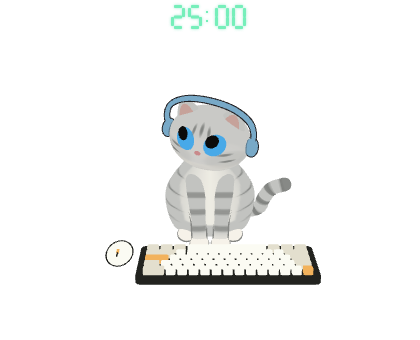
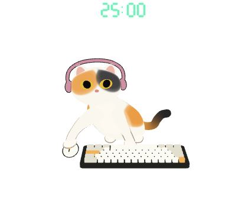
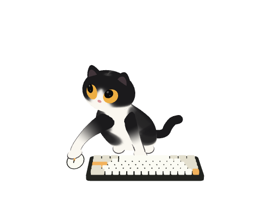
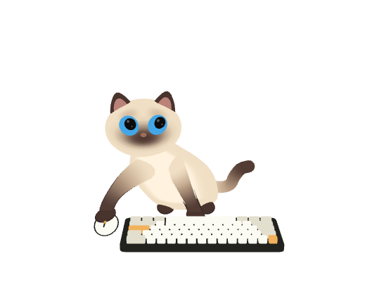
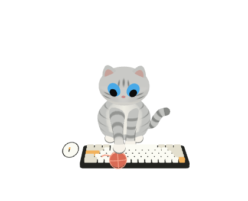
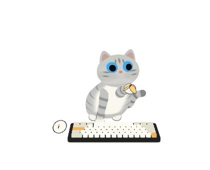
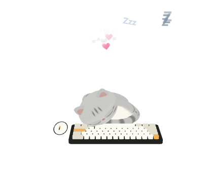
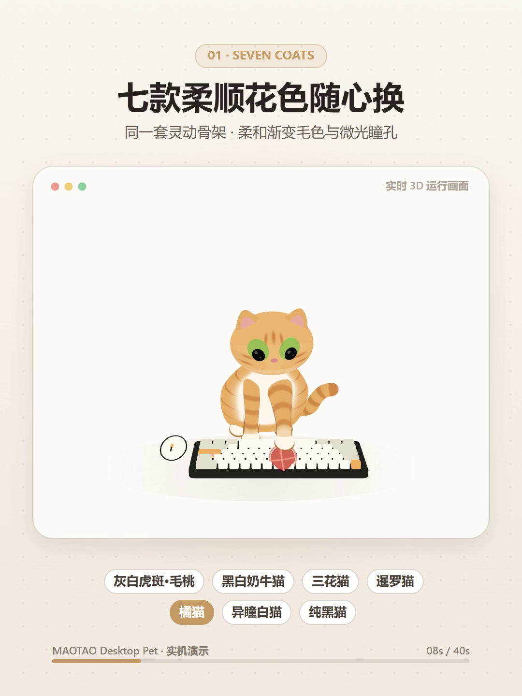

# MaoTao-Portable · 毛桃桌面宠物

<p align="center">
  <strong>一只陪你码字、专注与发呆的轻量级 3D 桌面小猫</strong><br/>
  基于 Electron + Three.js 本地程序化 3D 模型 · 离线零联网 · 透明桌面悬浮 · 七款萌猫花色 · 适配 Windows / macOS / 麒麟 Linux
</p>

<p align="center">
  
  
  
  
</p>

---

## ✨ 实机效果预览

| 专注模式 · 灰白虎斑（毛桃） | 专注模式 · 三花猫 | 黑白奶牛猫 | 暹罗猫 |
| :---: | :---: | :---: | :---: |
|  |  |  |  |

| 玩毛线球（点击改轨追抓） | 一键捉蝴蝶 | 侧躺蜷缩休眠 | 新增 · 橘猫花色 |
| :---: | :---: | :---: | :---: |
|  |  |  |  |

---

## 🎯 核心特性

- **七款柔顺渐变花色随心切换**
  - 内置 **灰白虎斑（毛桃）**、**黑白奶牛猫**（白底八字开脸 + 纯黑肩臂渐变白爪）、**三花猫**、**暹罗猫**（丝绒焦糖渐变重点色）、**橘猫**、**异瞳白猫**、**纯黑猫** 共 7 种花色，共用同一套圆润 3D 骨骼与低对比微光瞳孔。
- **真实键鼠实时联动**
  - 敲击键盘时双爪同步按压对应键位（空格键双爪联动），弹出键盘涟漪与低位防挡脸漂浮字母气泡；连续快速打字触发眯眼生气神态与尾巴拍桌反馈；隐藏键盘时自动拦截敲击动作。
  - 鼠标移动时小猫视线实时追踪桌面指针；鼠标静止约 10 秒后自动切换至待机玩毛线球动画。
- **25 分钟专注模式**
  - 一键开启 25 分钟番茄倒计时（绿色 7 段数码管显示于头顶上方），小猫佩戴极简圆润太阳穴贴合耳机（随机切换薄荷、雾蓝、薰衣草、珊瑚粉、暖杏 5 种纯色），随转头自然跟随无悬浮。
- **治愈逗猫互动与蜷缩睡姿**
  - 左键抚摸头顶触发眯眼呼噜，颜文字与心形气泡沿同一条头顶轨迹错峰飘升；支持点击毛线球改变滚动轨迹引导小猫追抓，也可在「互动动作」菜单一键召唤「玩毛线球」「捉蝴蝶」。
  - 长时间无操作或手动点击「睡觉 / 唤醒」进入**侧躺蜷缩成团**睡姿（尾巴绕身 + 轻缓呼吸 + Zzz），手动入睡不会被移动鼠标误唤醒。
- **高效分层菜单 & 隐私离线**
  - 右键 / 托盘菜单将「进入/退出待机」「更换花色」「专注模式」「显示键盘与鼠标」高频项置顶，其余功能按「互动动作」「外观与窗口」「声音与反馈」「键盘与输入」清晰分级收纳。
  - **100% 本地离线运行**，主进程主动拦截一切外网请求；跨应用输入联动默认关闭，需用户主动确认且仅传递左右手方向与键鼠类别，不读取、不保存任何输入文本或原始键码。

---

## 💻 多平台支持（Windows / macOS / 麒麟 Linux）

| 目标平台 | 支持架构 | 打包产物 | 平台说明 |
| --- | --- | --- | --- |
| **Windows 10/11** | `x64` | 便携版 `.exe`（约 99 MB）、NSIS 安装包 `.exe` | 开箱即用；未签名时 SmartScreen 提示可点击「仍要运行」 |
| **macOS（苹果）** | `x64` (Intel) / `arm64` (Apple Silicon) | `.dmg`、`.zip` | 跨应用联动首次使用需在「隐私与安全性 → 输入监控」授权 |
| **麒麟 Linux** | `x64` / `arm64` | `x64 .AppImage`、`x64/arm64 .deb` | X11 支持全局联动与置顶；Wayland 自动禁用全局钩子，本地互动正常 |

本仓库已内置 [`.github/workflows/package-platforms.yml`](.github/workflows/package-platforms.yml)，可在 GitHub Actions 中一键触发三平台云端自动打包并下载产物。

---

## 🚀 快速开始（开发运行）

环境要求：**Node.js 24+** 与 **npm**。

```powershell
# 1. 克隆仓库
git clone https://github.com/zkbrtdmvfp54-glitch/MaoTao-Portable.git
cd MaoTao-Portable

# 2. 安装依赖
npm ci
node node_modules/electron/install.js

# 3. 启动桌面宠物
npm start

# 4. 运行自动化单元测试（14 项）
npm test
```

---

## 📦 本地打包构建

已启用 `compression: "maximum"` 高压缩率打包并精简多余 Chromium 语言包（保留跨平台 `zh-CN / zh_CN / en-US / en`）。

```powershell
# Windows x64（便携版 EXE + NSIS 安装包）
pwsh -NoProfile -File scripts/build-win.ps1

# macOS（Intel / Apple Silicon DMG & ZIP，需在 macOS 上运行）
bash scripts/build-macos.sh

# 麒麟 Linux（x64 AppImage & x64/ARM64 DEB，需在 Linux 上运行）
bash scripts/build-kylin.sh
```

更多跨平台构建说明与架构文档见 [`docs/BUILD_AND_TEST.md`](docs/BUILD_AND_TEST.md)、[`docs/ART_DIRECTION.md`](docs/ART_DIRECTION.md) 与 [`docs/DEPENDENCY_AUDIT.md`](docs/DEPENDENCY_AUDIT.md)。

---

## 📂 项目结构

```text
├── src/
│   ├── main/                 # Electron 主进程（透明窗口、穿透掩码、托盘菜单、全局输入钩子、配置持久化）
│   ├── preload/              # 安全隔离的 IPC 预加载桥接
│   └── renderer/             # 渲染进程（状态机、2D/3D 合成渲染器、特效粒子、Web Audio 本地合成音效）
├── assets/
│   └── pet/
│       ├── processed/        # 应用图标与 2D 备用剪影素材
│       └── third-party/7paws # 本地程序化 3D 猫咪模型（基于 7wdn/7paws 衍生）与 Three.js r128
├── scripts/                  # 单元测试与 Windows / macOS / 麒麟 Linux 打包脚本
├── .github/workflows/        # GitHub Actions 三平台自动打包工作流
└── docs/                     # 画风规范、依赖审计、实机截图
```

---

## 🙏 致谢与开源许可

- 本项目以 **MIT License** 开源，详见 [`LICENSE`](LICENSE)。
- 3D 程序化猫咪与键盘基础场景衍生自 [`7wdn/7paws`](https://github.com/7wdn/7paws)（MIT License），并结合本项目进行角色比例、七款花色纹理、专注耳机、交互毛线球/蝴蝶与蜷缩睡姿重构。
- 依赖 [`Three.js r128`](https://threejs.org/)（MIT License）、[`Electron`](https://www.electronjs.org/)（MIT License）与 [`uiohook-napi`](https://github.com/SnosMe/uiohook-napi)（MIT / LGPL-3.0-or-later）。
